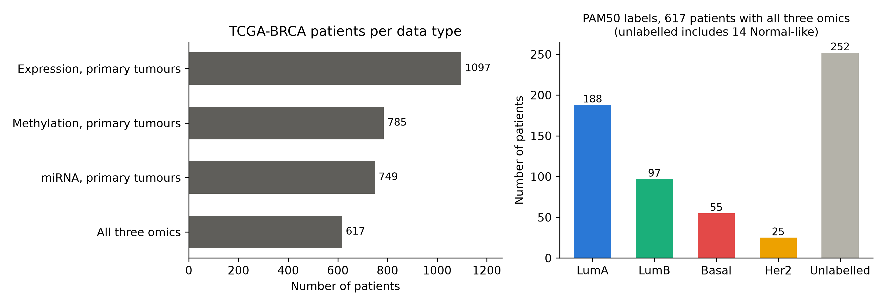
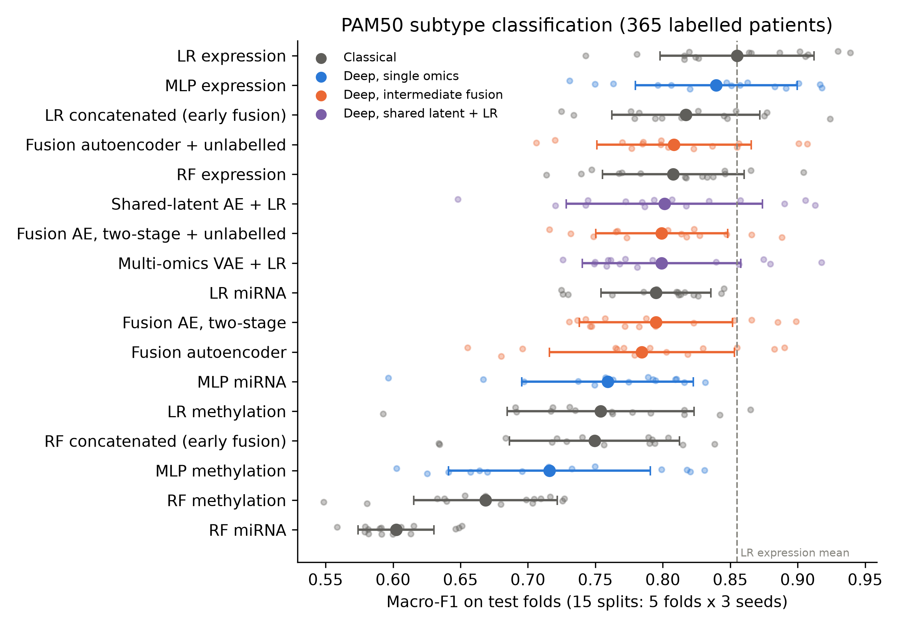
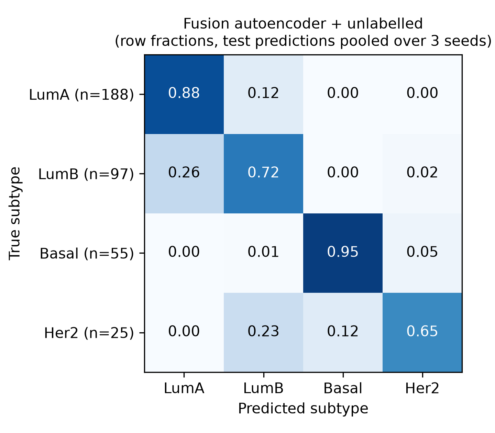
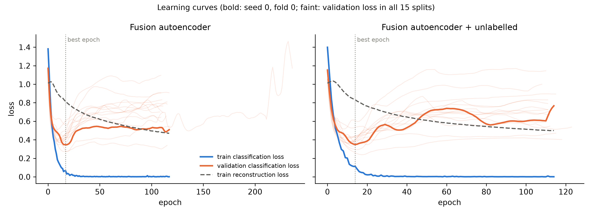
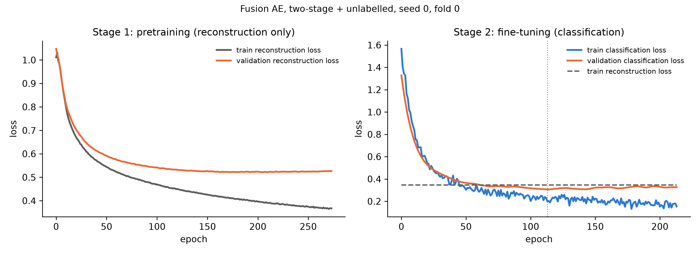
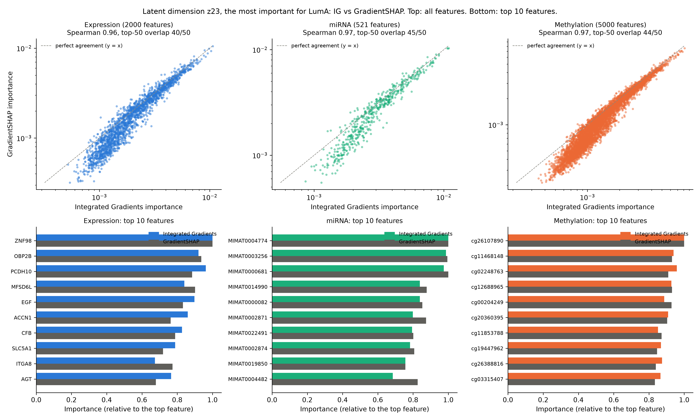
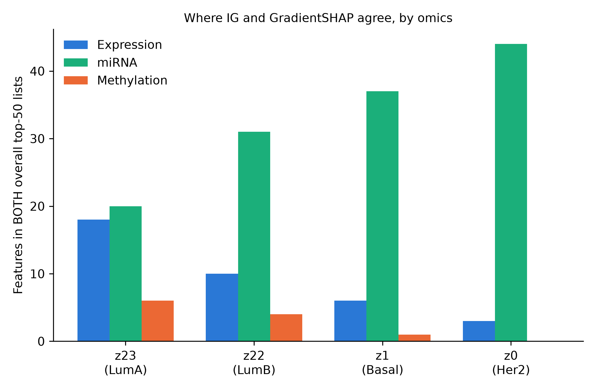

# When Does Deep Fusion Help? Multi-omics Integration for Breast Cancer Subtyping

**Status: work in progress.** The data pipeline, all models and the results below are complete and reproducible. The variational autoencoder and explainability analysis were added in November 2026. Further analyses are listed in [Next steps](#next-steps).

## Summary

This project asks whether deep learning models that fuse several omics layers classify breast cancer subtypes better than simple, well-regularized single-omics models, and what such models actually learn. Using 617 TCGA breast cancer patients with gene expression, DNA methylation and miRNA data, I compared linear models, random forests, single-omics neural networks, multi-omics fusion autoencoders and a multi-modal variational autoencoder (VAE), all evaluated on the same 15 cross-validation splits. I then interpreted the VAE latent space with Integrated Gradients and GradientSHAP.

**Main findings:**
- With 365 labelled patients, **no model outperformed L2-regularized logistic regression on gene expression alone** (macro-F1 0.855). Simple concatenation of the three omics made results worse, and every fusion autoencoder, including the VAE, reached about 0.80.
- **The VAE performed the same as a plain autoencoder with the same architecture** (0.799 vs 0.801, VAE better in 6 of 15 splits). Its KL term was active, without posterior collapse, but this regularisation did not change what a linear classifier can read from the latent space.
- **Integrated Gradients and GradientSHAP agreed closely** on which features drive the latent dimensions (rank correlation about 0.97). Attributions must be compared within each omics: mixed rankings are dominated by miRNAs largely because of the architecture, not the biology.

## Research questions

1. Does combining expression, methylation and miRNA improve PAM50 subtype classification compared with the best single omics?
2. Does a deep intermediate fusion model (one encoder per omics) do better than naive concatenation?
3. Do patients without a subtype label help, when used only to train the encoders (semi-supervised learning)?
4. Does a variational latent space give a better representation than a deterministic one, for the same architecture?
5. Which features drive the latent dimensions the classifier relies on, and do two attribution methods (Integrated Gradients and GradientSHAP) agree?

## Data

**Source:** The Cancer Genome Atlas, breast invasive carcinoma (TCGA-BRCA), from the UCSC Xena **TCGA Hub** (legacy processing, files dated 2018-07-22, downloaded 2026-10-13). All data used is open access.

| Data type | Measurement | Primary tumours |
|---|---|---|
| Gene expression | RNA-seq, log2(RSEM normalized count + 1), 20,530 genes | 1,097 |
| DNA methylation | Illumina 450k array, beta values, 485,577 CpG probes | 785 |
| miRNA expression | Illumina HiSeq, 2,238 miRNAs | 749 |
| Clinical | PAM50 labels (`PAM50Call_RNAseq`) | |

**Final cohort:** 617 patients with all three omics, of which **365 have a usable PAM50 label** (LumA 188, LumB 97, Basal 55, Her2 25) and **252 are unlabelled** (238 without a label, 14 Normal-like).



### Preprocessing and data decisions

| Decision | Reason |
|---|---|
| Primary tumour samples only (TCGA code `01`), one per patient | Avoid normal tissue and duplicate patients across splits |
| Remove the 50 PAM50 genes from the expression data | The labels were computed from these genes on this same RNA-seq data. Removing them reduces circularity; it does not eliminate it, since correlated genes remain |
| Exclude Normal-like as a class (14 patients) | Debated as a true subtype (possibly normal tissue contamination) and too few patients to evaluate. These patients are kept as unlabelled |
| miRNA: drop miRNAs missing in at least 20% of patients, fill the rest with 0 | Missing values in this file mean "not detected" (the file contains no zeros) |
| Methylation: drop probes missing in at least 5% of patients | 89,512 probes are missing in every sample; the rest are almost complete |
| No relabelling from the 2012 microarray PAM50 calls | Only 3 of the 238 unlabelled patients could have been recovered |

The PAM50 gene list (Parker et al. 2009, J Clin Oncol) is in `data/pam50_genes.txt`. `ORC6` appears as its older name `ORC6L` in the Xena file.

## Methods

### Evaluation protocol

- **Stratified 5-fold cross-validation, repeated with 3 seeds:** 15 train/test splits, saved once in `results/splits.csv` and **reused by every model**, so all comparisons are paired.
- **No information from the test fold is used for training:** feature selection (top features by variance), imputation and scaling are fitted on the training side of each split only. Hyperparameters are chosen by an inner cross-validation (logistic regression) or on a validation set taken from the training side (neural networks).
- **Metrics:** macro-F1 (main metric, robust to class imbalance) and balanced accuracy.
- **Features kept per split:** top 2,000 genes, all 521 miRNAs, top 5,000 CpG probes, ranked by variance on the training side.

### Models

| Model | Description |
|---|---|
| **LR** | L2-regularized logistic regression; regularization strength chosen by inner 3-fold CV over 8 values |
| **RF** | Random forest, 500 trees, default settings (no tuning, no class weighting) |
| **LR / RF concatenated** | The three omics side by side, each block selected and scaled separately (early fusion) |
| **MLP** | One hidden layer (256 units, ReLU), dropout, AdamW; weight decay chosen on validation; early stopping |
| **Fusion autoencoder, joint** | One encoder per omics (to a 32-dimensional latent vector) and one decoder per omics. The three latent vectors are concatenated and passed to a classifier. Loss = classification loss + weighted reconstruction loss, trained together. Weight decay and reconstruction weight chosen on validation |
| **Fusion autoencoder, two-stage** | Same architecture. Stage 1: encoders and decoders trained on reconstruction only, until the validation reconstruction loss stops improving. Stage 2: classifier trained on labelled patients, with encoders either frozen or fine-tuned (chosen on validation) |
| **+ unlabelled** | The 252 unlabelled patients are added to the training side and contribute to the reconstruction loss only. They never appear in validation or test sets |
| **Multi-modal VAE + LR** | One encoder per omics, outputs concatenated into a **shared** layer that gives a mean μ and a log-variance for 32 latent dimensions; z = μ + σ·ε (reparameterisation trick); one decoder per omics reconstructs it from the shared z. Loss = reconstruction + β·KL(q(z\|x) ‖ N(0, I)), β = 1 with linear KL warm-up over 200 epochs. Trained on the training side including the unlabelled patients; then L2 logistic regression on μ (same classifier as the LR baselines) |
| **Multi-modal AE + LR** | Identical architecture and training, but deterministic (z = μ) and no KL term: the controlled comparison for the VAE |

**Two details of the VAE loss that matter:**
- **Reconstruction is summed over features, not averaged.** With about 7,500 input features, an averaged reconstruction error would be tiny compared with the KL summed over 32 dimensions, and the model would collapse (all latent dimensions ignored).
- **Each omics is reweighted** so the three contribute equally to the reconstruction loss. Otherwise methylation (5,000 of 7,521 features) would dominate.

### Explainability

The VAE trained on one split (seed 0, fold 0) was interpreted on its test patients.

1. **Which latent dimensions matter:** for each subtype, the latent dimension with the largest coefficient in the logistic regression on μ.
2. **Which features drive them:** the function explained is F(x) = μ_k(x), one latent dimension at a time.
   - **Integrated Gradients (IG):** one baseline, the all-zero input, which is the **average training patient** (features are standardized on the training side). Attributions sum to F(x) − F(baseline) (completeness), which was checked.
   - **GradientSHAP:** expected gradients, i.e. IG averaged over baselines drawn from 100 real training patients. Exact or Kernel SHAP is infeasible with about 7,500 features.
   - Global importance of a feature = mean absolute attribution over test patients.
3. **Agreement:** Spearman rank correlation of global importances, and overlap of the top 50 features, overall and within each omics.

## Results

Macro-F1 and balanced accuracy over the 15 test folds (mean ± standard deviation). The last two columns compare each model with LR on expression, split by split.

| Model | Macro-F1 | Balanced accuracy | Diff. vs LR expression | Splits won vs LR expression |
|---|---|---|---|---|
| **LR expression** | **0.855 ± 0.057** | **0.856 ± 0.063** | reference | |
| LR miRNA | 0.795 ± 0.041 | 0.785 ± 0.047 | −0.060 | 2/15 |
| LR methylation | 0.754 ± 0.069 | 0.755 ± 0.071 | −0.101 | 0/15 |
| LR concatenated | 0.817 ± 0.055 | 0.812 ± 0.058 | −0.038 | 2/15 |
| RF expression | 0.808 ± 0.052 | 0.783 ± 0.059 | −0.047 | 5/15 |
| RF miRNA | 0.602 ± 0.028 | 0.609 ± 0.028 | −0.253 | 0/15 |
| RF methylation | 0.669 ± 0.053 | 0.645 ± 0.039 | −0.187 | 0/15 |
| RF concatenated | 0.749 ± 0.063 | 0.722 ± 0.053 | −0.106 | 1/15 |
| MLP expression | 0.840 ± 0.060 | 0.845 ± 0.063 | −0.015 | 5/15 |
| MLP miRNA | 0.759 ± 0.064 | 0.751 ± 0.052 | −0.096 | 2/15 |
| MLP methylation | 0.716 ± 0.075 | 0.717 ± 0.077 | −0.139 | 0/15 |
| Fusion AE, joint | 0.785 ± 0.069 | 0.783 ± 0.068 | −0.071 | 3/15 |
| Fusion AE, joint + unlabelled | 0.808 ± 0.057 | 0.801 ± 0.063 | −0.047 | 5/15 |
| Fusion AE, two-stage | 0.795 ± 0.057 | 0.795 ± 0.063 | −0.060 | 1/15 |
| Fusion AE, two-stage + unlabelled | 0.799 ± 0.049 | 0.798 ± 0.056 | −0.056 | 2/15 |
| Multi-modal AE + LR (shared latent) | 0.801 ± 0.073 | 0.792 ± 0.074 | −0.054 | 3/15 |
| Multi-modal VAE + LR (shared latent) | 0.799 ± 0.059 | 0.790 ± 0.070 | −0.056 | 2/15 |



### Key findings

1. **A regularized linear model on expression is the strongest model.** Neither non-linear classical models (random forest) nor neural networks outperformed it. With 365 labelled patients, the subtype signal appears to be captured well by a linear model, and more flexible models mainly add variance.
2. **Naive concatenation hurts.** Combining the three omics in one linear model performed worse than expression alone in 13 of 15 splits. A likely reason: methylation, the weakest omics, contributes two thirds of the concatenated features.
3. **Intermediate fusion did not close the gap.** All fusion autoencoders, including the VAE, reached between 0.785 and 0.808 macro-F1, below expression alone in most splits.
4. **The gap is not a training artifact.** With joint training, the classifier overfits within about 15 epochs, while the reconstruction loss is still decreasing (Figure 4), so the autoencoder is under-trained. Two-stage training fixes this: the autoencoder reaches a stable validation plateau and the classifier shows no runaway overfitting (Figure 5). Performance stays around 0.80. In 14 of 15 splits, the validation set preferred frozen encoders, so the classifier works directly on the unsupervised representation. This representation keeps most, but not all, of the subtype information.
5. **The effect of unlabelled patients is not consistent.** They raised mean macro-F1 by 0.023 with joint training, but only by 0.004 with two-stage training, where they are used most directly. I do not claim that they help.
6. **Errors follow biology and label noise.** Most errors are between Luminal A and Luminal B, the same pair on which the two TCGA PAM50 label versions disagree (about 90% agreement overall). Basal tumours are almost always recognised (95%). Her2 is the hardest class (25 patients), often predicted as LumB or Basal.



### Training diagnostics



*Figure 4: joint training. The training classification loss reaches almost zero within about 15 epochs, while the reconstruction loss is still decreasing at the early-stopping point. The faint lines show the same pattern in all 15 splits.*



*Figure 5: two-stage training. Left: the autoencoder trains until the validation reconstruction loss plateaus. Right: with frozen encoders (flat reconstruction line), training and validation classification losses decrease together, with a small and stable gap.*

### Variational autoencoder: what changed and what did not

**No posterior collapse.** All 32 latent dimensions were active in all 15 splits (variance of μ across patients above 0.01), and no dimension had a KL contribution near zero.

**The KL term was active but moderate** (seed 0, fold 0): posterior standard deviations σ ≈ 0.15 in every dimension, against a spread of μ across patients of about 2.1, with a total KL of about 116 nats per patient. Each patient is encoded as a small region rather than a point, so the latent space is regularised, but the noise is only about 7% of the distance between patients.

**Same classification performance as the deterministic autoencoder.** VAE and AE with identical architecture, training data and classifier differed by 0.002 macro-F1, with the VAE better in 6 of 15 splits. The variational regularisation changed the geometry of the latent space, but not what a linear classifier can read from it.

### Explainability: Integrated Gradients vs GradientSHAP

Latent dimensions most important for each subtype: **z23 (LumA), z22 (LumB), z1 (Basal), z0 (Her2)**.

| Dimension | Subtype | Spearman (all features) | Top-50 overlap | IG completeness error | Share of importance: expression / miRNA / methylation (IG) |
|---|---|---|---|---|---|
| z23 | LumA | 0.969 | 44/50 | ≈ 0 | 0.33 / 0.12 / 0.56 |
| z22 | LumB | 0.974 | 45/50 | ≈ 0 | 0.31 / 0.14 / 0.56 |
| z1 | Basal | 0.970 | 44/50 | ≈ 0 | 0.28 / 0.14 / 0.58 |
| z0 | Her2 | 0.968 | 47/50 | ≈ 0 | 0.33 / 0.16 / 0.51 |



*Figure 6: latent dimension z23 (most important for LumA). Top: each dot is one feature, IG importance against GradientSHAP importance; the dashed line is perfect agreement. Bottom: the 10 most important features per omics, each method scaled to its own top feature.*

**1. The two methods agree closely.** Spearman about 0.97 in every dimension and within every omics (z23: 0.964 expression, 0.966 miRNA, 0.967 methylation). IG uses one baseline, the average training patient; GradientSHAP averages over real training patients, whose mean is that same baseline. Close agreement therefore indicates that the encoder behaves almost linearly over the region occupied by real patients, consistent with the strength of the linear baselines.

**2. A prediction that did not hold.** I expected the most disagreement in methylation, because many CpGs are bimodal and the "average patient" baseline sits between the two modes, where few real patients lie. Methylation agreed as well as the other omics. A likely explanation: for a near-linear encoder, the position of the baseline matters little once attributions are averaged over patients.

**3. Compare attributions within omics, not across them.** Methylation receives about 55% of the total importance, miRNA only 12 to 16%, yet mixed top-10 lists are dominated by miRNAs (all 10 for z1 and z0). Methylation importance is spread over 5,000 CpGs, miRNA importance over only 521 features. Part of this is architectural: each omics has its own encoder with the same 256 hidden units, so each miRNA feeds more weight per input. A miRNA at the top of a mixed list does not mean miRNAs matter more biologically.

**4. A hypothesis about what some dimensions capture.** The top expression features of z23 (LumA) include genes associated with adipose and stromal tissue (for example AGT and CFB), and those of z22 (LumB) include skeletal muscle genes (ACTA1, ACTN2). This suggests that some latent dimensions capture the **tissue composition of the sample** (fat, stroma, muscle) rather than tumour biology itself. This is a hypothesis, not a finding: it has not been tested.



*Figure 7: number of features shared by the two methods' top-50 lists, by omics, for the four latent dimensions.*

## Limitations

- **Small labelled cohort** (365 patients, 25 in the smallest class). The spread between splits is large (standard deviations around 0.05), so small differences between models are not meaningful.
- **Splits are not independent** (training sets overlap), so differences are reported as paired win counts, not formal significance tests.
- **Labels are not independent of the input.** PAM50 labels come from expression data; removing the 50 PAM50 genes reduces but does not remove this circularity, which favours expression-based models.
- **Limited hyperparameter search** for the neural networks and no tuning for the random forest. **The VAE used β = 1 without tuning.** Other architectures or settings could perform differently.
- **Interpretation on one model** (seed 0, fold 0), not repeated across splits.
- **Attribution agreement is not proof of correctness.** Both methods are gradient-based and share assumptions, for example how importance is split among correlated features. Importance is the mean **absolute** attribution, so it does not show whether a feature pushes a latent dimension up or down.
- **miRNAs are shown as MIMAT accession numbers**, without conversion to miRBase names.
- **One cohort.** All results come from TCGA. Performance on other cohorts (other hospitals, other protocols) is unknown.
- **One task.** Conclusions may not hold for other tasks, such as survival prediction, where the omics may carry more complementary information.

## Next steps

- [ ] **Tissue composition hypothesis:** correlate the latent dimensions with published TCGA tumour purity estimates
- [ ] **β sensitivity:** repeat the VAE with stronger regularisation (larger β)
- [ ] **Perturbation test:** remove the top-ranked features and check that the latent dimension changes most, to validate the attributions
- [ ] **Direction of effects** and **interpretation across all 15 splits**, to check that the top features are stable
- [ ] **miRNA names** from miRBase, and pathway-level aggregation of attributions
- [ ] **Modality ablation:** retrain the fusion model with one omics removed, to see which omics it actually uses
- [ ] **Latent space visualisation (UMAP):** check whether subtypes separate in the fused representation, and where Normal-like patients fall
- [ ] **Non-circular labels:** predict receptor status (ER, PR, HER2), measured by immunohistochemistry independently of RNA-seq
- [ ] **Survival prediction** with the TCGA Pan-Cancer clinical data resource
- [ ] **External validation** on an independent breast cancer cohort (for example METABRIC)

## Repository structure

```
├── data/
│   ├── pam50_genes.txt           PAM50 gene list (with source)
│   ├── raw/                      downloaded files (not in the repository)
│   └── processed/                output of 02_build_dataset.py (not in the repository)
├── scripts/
│   ├── 02_build_dataset.py       filtering, QC, alignment of the three omics, labels
│   ├── 03_run_baselines.py       logistic regression and random forest, creates the CV splits
│   ├── 04_run_mlp.py             single-omics neural networks
│   ├── 05_run_fusion.py          fusion autoencoder: joint and two-stage, with and without unlabelled patients
│   ├── 06_make_figures.py        figures and results table
│   ├── 07_run_vae.py             multi-modal VAE vs AE (shared latent), logistic regression on latent means
│   └── 08_interpret_vae.py       Integrated Gradients and GradientSHAP on the VAE latent dimensions
├── notebooks/                    data exploration
├── results/                      metrics per split, summaries, predictions, learning curves, attributions
└── figures/
```

## How to reproduce

**1. Environment** (Python 3.11):
```
conda create -n mofusion python=3.11
conda activate mofusion
pip install -r requirements.txt
```
For GPU support, install PyTorch with the command from pytorch.org for your system. All scripts also run on CPU.

**2. Data.** From [UCSC Xena](https://xenabrowser.net), TCGA Hub, cohort *TCGA Breast Cancer (BRCA)*, download into `data/raw/`:
- `TCGA.BRCA.sampleMap_HiSeqV2.gz` (gene expression RNAseq, IlluminaHiSeq)
- `TCGA.BRCA.sampleMap_HumanMethylation450.gz` (DNA methylation, Methylation450k)
- `TCGA.BRCA.sampleMap_miRNA_HiSeq_gene.gz` (miRNA mature strand expression, IlluminaHiseq)
- `TCGA.BRCA.sampleMap_BRCA_clinicalMatrix` (phenotypes)

**3. Run the pipeline** from the repository root:
```
python scripts/02_build_dataset.py
python scripts/03_run_baselines.py
python scripts/04_run_mlp.py
python scripts/05_run_fusion.py
python scripts/06_make_figures.py
python scripts/07_run_vae.py
python scripts/08_interpret_vae.py
```
Total runtime is about 40 minutes on a recent GPU.

