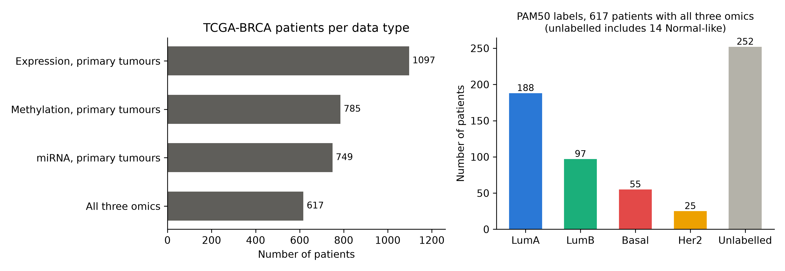
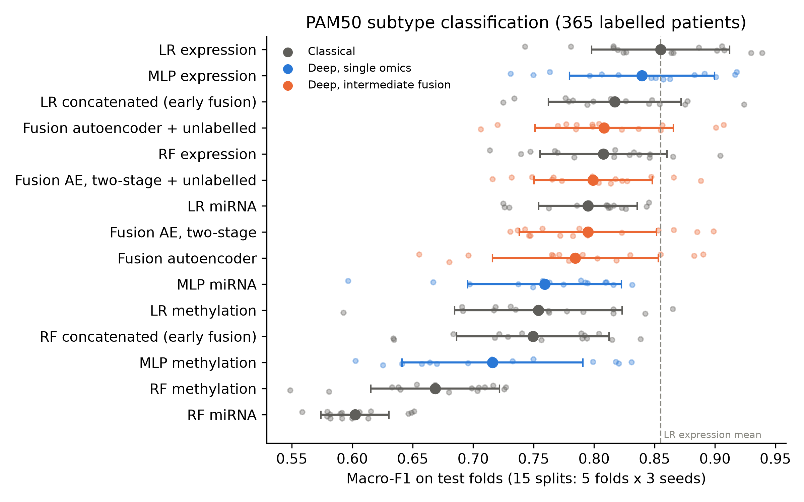
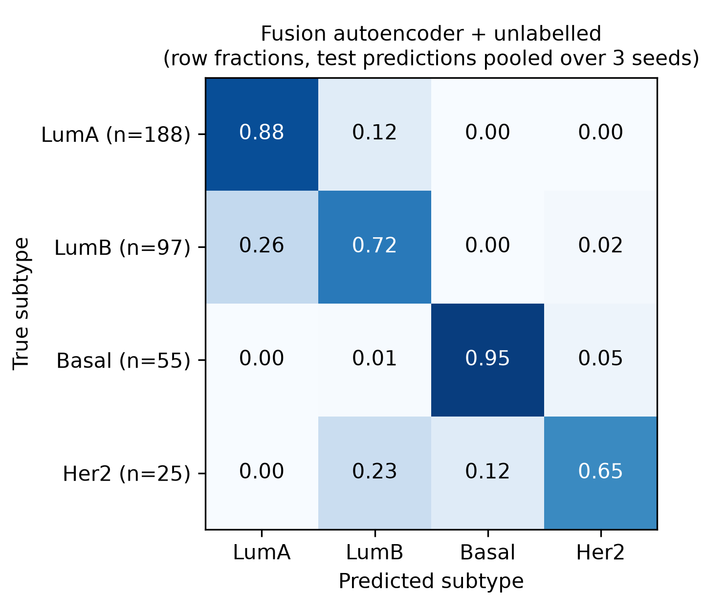
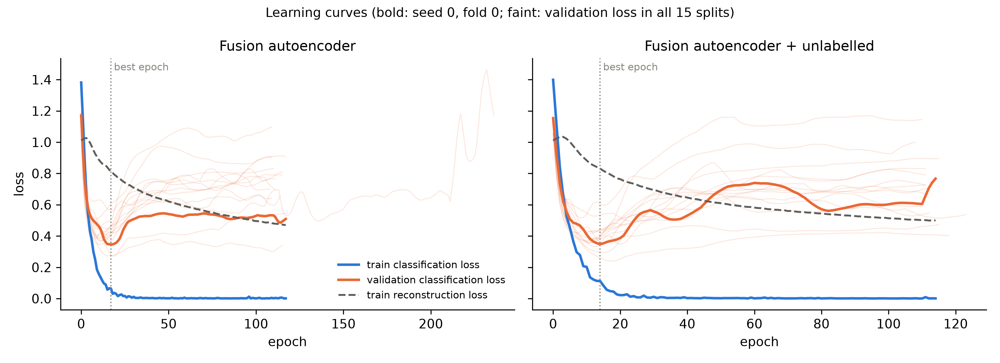
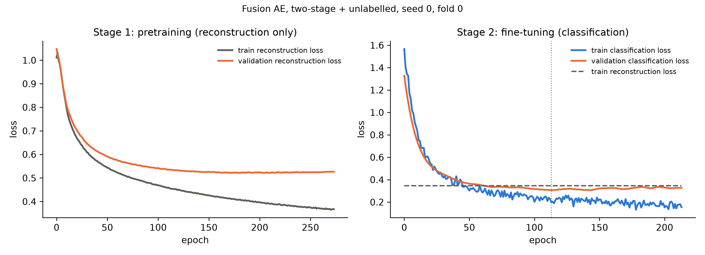

# When Does Deep Fusion Help? Multi-omics Integration for Breast Cancer Subtyping

**Status: work in progress.** The data pipeline, all models and the results below are complete and reproducible. Further analyses are listed in [Next steps](#next-steps).

## Summary

This project asks whether deep learning models that fuse several omics layers classify breast cancer subtypes better than simple, well-regularized single-omics models. Using 617 TCGA breast cancer patients with gene expression, DNA methylation and miRNA data, I compared linear models, random forests, single-omics neural networks and a multi-omics fusion autoencoder, all evaluated on the same 15 cross-validation splits.

**Main finding:** with 365 labelled patients, no model outperformed L2-regularized logistic regression on gene expression alone (macro-F1 0.855). Simple concatenation of the three omics made results worse, and the fusion autoencoder reached about 0.80 whether trained jointly or in two stages. Learning curves show that the two-stage model is properly trained, so the gap is not a training artifact: an unsupervised fused representation keeps most, but not all, of the subtype information. Adding 252 unlabelled patients gave a small gain with joint training but almost none with two-stage training, so the evidence that unlabelled data helps is not consistent.

## Research questions

1. Does combining expression, methylation and miRNA improve PAM50 subtype classification compared with the best single omics?
2. Does a deep intermediate fusion model (one encoder per omics) do better than naive concatenation?
3. Do patients without a subtype label help, when used only to train the encoders (semi-supervised learning)?

## Data

**Source:** The Cancer Genome Atlas, breast invasive carcinoma (TCGA-BRCA), from the UCSC Xena **TCGA Hub** (legacy processing, files dated 2018-07-22, downloaded 2026-10-13). All data used is open access.

| Data type | Measurement | Primary tumours |
|---|---|---|
| Gene expression | RNA-seq, log2(RSEM normalized count + 1), 20,530 genes | 1,097 |
| DNA methylation | Illumina 450k array, beta values, 485,577 CpG probes | 785 |
| miRNA expression | Illumina HiSeq, 2,238 miRNAs | 749 |
| Clinical | PAM50 labels (`PAM50Call_RNAseq`) | |

**Final cohort:** 617 patients with all three omics, of which **365 have a usable PAM50 label** (LumA 188, LumB 97, Basal 55, Her2 25) and **252 are unlabelled** (238 without a label, 14 Normal-like).



### Preprocessing and data decisions

| Decision | Reason |
|---|---|
| Primary tumour samples only (TCGA code `01`), one per patient | Avoid normal tissue and duplicate patients across splits |
| Remove the 50 PAM50 genes from the expression data | The labels were computed from these genes on this same RNA-seq data. Removing them reduces circularity; it does not eliminate it, since correlated genes remain |
| Exclude Normal-like as a class (14 patients) | Debated as a true subtype (possibly normal tissue contamination) and too few patients to evaluate. These patients are kept as unlabelled |
| miRNA: drop miRNAs missing in at least 20% of patients, fill the rest with 0 | Missing values in this file mean "not detected" (the file contains no zeros) |
| Methylation: drop probes missing in at least 5% of patients | 89,512 probes are missing in every sample; the rest are almost complete |
| No relabelling from the 2012 microarray PAM50 calls | Only 3 of the 238 unlabelled patients could have been recovered |

The PAM50 gene list (Parker et al. 2009, J Clin Oncol) is in `data/pam50_genes.txt`. `ORC6` appears as its older name `ORC6L` in the Xena file.

## Methods

### Evaluation protocol

- **Stratified 5-fold cross-validation, repeated with 3 seeds:** 15 train/test splits, saved once in `results/splits.csv` and **reused by every model**, so all comparisons are paired.
- **No information from the test fold is used for training:** feature selection (top features by variance), imputation and scaling are fitted on the training side of each split only. Hyperparameters are chosen by an inner cross-validation (logistic regression) or on a validation set taken from the training side (neural networks).
- **Metrics:** macro-F1 (main metric, robust to class imbalance) and balanced accuracy.
- **Features kept per split:** top 2,000 genes, all 521 miRNAs, top 5,000 CpG probes, ranked by variance on the training side.

### Models

| Model | Description |
|---|---|
| **LR** | L2-regularized logistic regression; regularization strength chosen by inner 3-fold CV over 8 values |
| **RF** | Random forest, 500 trees, default settings (no tuning, no class weighting) |
| **LR / RF concatenated** | The three omics side by side, each block selected and scaled separately (early fusion) |
| **MLP** | One hidden layer (256 units, ReLU), dropout, AdamW; weight decay chosen on validation; early stopping |
| **Fusion autoencoder, joint** | One encoder per omics (to a 32-dimensional latent vector) and one decoder per omics. The three latent vectors are concatenated and passed to a classifier. Loss = classification loss + weighted reconstruction loss, trained together. Weight decay and reconstruction weight chosen on validation |
| **Fusion autoencoder, two-stage** | Same architecture. Stage 1: encoders and decoders trained on reconstruction only, until the validation reconstruction loss stops improving. Stage 2: classifier trained on labelled patients, with encoders either frozen or fine-tuned (chosen on validation) |
| **+ unlabelled** | The 252 unlabelled patients are added to the training side and contribute to the reconstruction loss only. They never appear in validation or test sets |

## Results

Macro-F1 and balanced accuracy over the 15 test folds (mean ± standard deviation). The last two columns compare each model with LR on expression, split by split.

| Model | Macro-F1 | Balanced accuracy | Diff. vs LR expression | Splits won vs LR expression |
|---|---|---|---|---|
| **LR expression** | **0.855 ± 0.057** | **0.856 ± 0.063** | reference | |
| LR miRNA | 0.795 ± 0.041 | 0.785 ± 0.047 | −0.060 | 2/15 |
| LR methylation | 0.754 ± 0.069 | 0.755 ± 0.071 | −0.101 | 0/15 |
| LR concatenated | 0.817 ± 0.055 | 0.812 ± 0.058 | −0.038 | 2/15 |
| RF expression | 0.808 ± 0.052 | 0.783 ± 0.059 | −0.047 | 5/15 |
| RF miRNA | 0.602 ± 0.028 | 0.609 ± 0.028 | −0.253 | 0/15 |
| RF methylation | 0.669 ± 0.053 | 0.645 ± 0.039 | −0.187 | 0/15 |
| RF concatenated | 0.749 ± 0.063 | 0.722 ± 0.053 | −0.106 | 1/15 |
| MLP expression | 0.840 ± 0.060 | 0.845 ± 0.063 | −0.015 | 5/15 |
| MLP miRNA | 0.759 ± 0.064 | 0.751 ± 0.052 | −0.096 | 2/15 |
| MLP methylation | 0.716 ± 0.075 | 0.717 ± 0.077 | −0.139 | 0/15 |
| Fusion AE, joint | 0.785 ± 0.069 | 0.783 ± 0.068 | −0.071 | 3/15 |
| Fusion AE, joint + unlabelled | 0.808 ± 0.057 | 0.801 ± 0.063 | −0.047 | 5/15 |
| Fusion AE, two-stage | 0.795 ± 0.057 | 0.795 ± 0.063 | −0.060 | 1/15 |
| Fusion AE, two-stage + unlabelled | 0.799 ± 0.049 | 0.798 ± 0.056 | −0.056 | 2/15 |



### Key findings

1. **A regularized linear model on expression is the strongest model.** Neither non-linear classical models (random forest) nor neural networks outperformed it. With 365 labelled patients, the subtype signal appears to be captured well by a linear model, and more flexible models mainly add variance.
2. **Naive concatenation hurts.** Combining the three omics in one linear model performed worse than expression alone in 13 of 15 splits. A likely reason: methylation, the weakest omics, contributes two thirds of the concatenated features.
3. **Intermediate fusion did not close the gap.** All four fusion autoencoder versions reached between 0.785 and 0.808 macro-F1, below expression alone in most splits.
4. **The gap is not a training artifact.** With joint training, the classifier overfits within about 15 epochs, while the reconstruction loss is still decreasing (Figure 4), so the autoencoder is under-trained. Two-stage training fixes this: the autoencoder reaches a stable validation plateau and the classifier shows no runaway overfitting (Figure 5). Performance stays around 0.80. In 14 of 15 splits, the validation set preferred frozen encoders, so the classifier works directly on the unsupervised representation. This representation keeps most, but not all, of the subtype information.
5. **The effect of unlabelled patients is not consistent.** They raised mean macro-F1 by 0.023 with joint training, but only by 0.004 with two-stage training, where they are used most directly. I do not claim that they help.
6. **Errors follow biology and label noise.** Most errors are between Luminal A and Luminal B, the same pair on which the two TCGA PAM50 label versions disagree (about 90% agreement overall). Basal tumours are almost always recognised (95%). Her2 is the hardest class (25 patients), often predicted as LumB or Basal.



### Training diagnostics



*Figure 4: joint training. The training classification loss reaches almost zero within about 15 epochs, while the reconstruction loss is still decreasing at the early-stopping point. The faint lines show the same pattern in all 15 splits.*



*Figure 5: two-stage training. Left: the autoencoder trains until the validation reconstruction loss plateaus. Right: with frozen encoders (flat reconstruction line), training and validation classification losses decrease together, with a small and stable gap.*

## Limitations

- **Small labelled cohort** (365 patients, 25 in the smallest class). The spread between splits is large (standard deviations around 0.05), so small differences between models are not meaningful.
- **Splits are not independent** (training sets overlap), so differences are reported as paired win counts, not formal significance tests.
- **Labels are not independent of the input.** PAM50 labels come from expression data; removing the 50 PAM50 genes reduces but does not remove this circularity, which favours expression-based models.
- **Limited hyperparameter search** for the neural networks and no tuning for the random forest. Other architectures or settings could perform differently.
- **One cohort.** All results come from TCGA. Performance on other cohorts (other hospitals, other protocols) is unknown.
- **One task.** Conclusions may not hold for other tasks, such as survival prediction, where the omics may carry more complementary information.

## Next steps

- [ ] **Modality ablation:** retrain the fusion model with one omics removed, to see which omics it actually uses
- [ ] **Latent space visualisation (UMAP):** check whether subtypes separate in the fused representation, and where Normal-like patients fall
- [ ] **Non-circular labels:** predict receptor status (ER, PR, HER2), measured by immunohistochemistry independently of RNA-seq
- [ ] **Survival prediction** with the TCGA Pan-Cancer clinical data resource
- [ ] **External validation** on an independent breast cancer cohort (for example METABRIC)

## Repository structure

```
├── data/
│   ├── pam50_genes.txt           PAM50 gene list (with source)
│   ├── raw/                      downloaded files (not in the repository)
│   └── processed/                output of 02_build_dataset.py (not in the repository)
├── scripts/
│   ├── 02_build_dataset.py       filtering, QC, alignment of the three omics, labels
│   ├── 03_run_baselines.py       logistic regression and random forest, creates the CV splits
│   ├── 04_run_mlp.py             single-omics neural networks
│   ├── 05_run_fusion.py          fusion autoencoder: joint and two-stage, with and without unlabelled patients
│   └── 06_make_figures.py        figures and results table
├── notebooks/                    data exploration
├── results/                      metrics per split, summaries, predictions, learning curves
└── figures/
```

## How to reproduce

**1. Environment** (Python 3.11):
```
conda create -n mofusion python=3.11
conda activate mofusion
pip install -r requirements.txt
```
For GPU support, install PyTorch with the command from pytorch.org for your system. All scripts also run on CPU.

**2. Data.** From [UCSC Xena](https://xenabrowser.net), TCGA Hub, cohort *TCGA Breast Cancer (BRCA)*, download into `data/raw/`:
- `TCGA.BRCA.sampleMap_HiSeqV2.gz` (gene expression RNAseq, IlluminaHiSeq)
- `TCGA.BRCA.sampleMap_HumanMethylation450.gz` (DNA methylation, Methylation450k)
- `TCGA.BRCA.sampleMap_miRNA_HiSeq_gene.gz` (miRNA mature strand expression, IlluminaHiseq)
- `TCGA.BRCA.sampleMap_BRCA_clinicalMatrix` (phenotypes)

**3. Run the pipeline** from the repository root:
```
python scripts/02_build_dataset.py
python scripts/03_run_baselines.py
python scripts/04_run_mlp.py
python scripts/05_run_fusion.py
python scripts/06_make_figures.py
```
Total runtime is about 20 minutes on a recent GPU.

## Author

Hicham Attioui, bioinformatics engineer. GitHub: [hicham-attioui](https://github.com/hicham-attioui)
